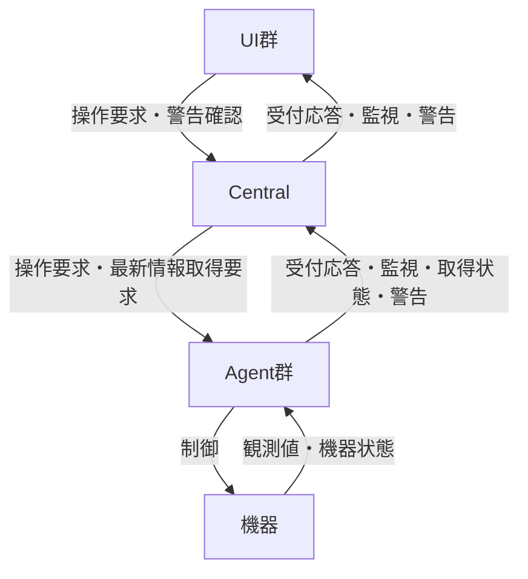
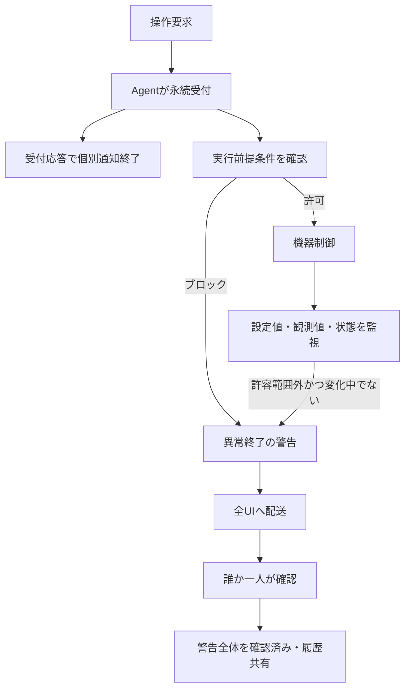

# Metis 通信規格：UI–Central／Central–Agent 統合整理

更新日：2026-09-30

## 1. 文書の位置付け

2026年9月28〜30日の通信規格に関する議論を、操作・監視・警告の3種類、UI–CentralとCentral–Agentの2経路について統合した設計文書である。後の決定を先行する提案より優先した。ユーザーが決定を行い、助手は選択肢と長短を提示するという進め方を維持する。

本書の「合意事項」は設計方針であり、実装済みの挙動を意味しない。「候補」「未決定」は今後の検討材料であり、必須仕様ではない。具体的なAPI、JSONキー、通信方式、タイムアウト値等の確定には至っていない。

ここでのヘッダーはメッセージの共通メタデータを意味し、HTTPヘッダーそのものとは限らない。通信単位はヘッダーとペイロードを持つメッセージとする。

## 2. 全体構成と責任

| 構成要素 | 主な責任 |
|---|---|
| UI | 操作要求、監視値の表示・フィルタリング、ユーザーによる警告確認、履歴閲覧 |
| Central | 操作の仲介と受付待機、登録情報・履歴の保持、最新監視値の保持と全UIへの配信、警告の配送と確認管理 |
| Agent | 機器固有の取得・制御、要求の永続受付、実行条件の判断、到達順処理とガード、監視値・取得状態・警告の提供 |

### 2.1 2経路×3種類の関係

| 種類 | UI–Central | Central–Agent | 両経路の関係 |
|---|---|---|---|
| 操作 | UI→Centralの要求、Central→要求元UIの受付応答 | Central→Agentの要求、Agent→Centralの受付応答 | Agentの永続受付をCentralが確認してUIへ応答する |
| 監視 | Central→全UIの最新値・変更値・取得状態 | Agent→Centralの取得情報・keep-alive、Central→Agentの起動後最新情報取得要求 | Centralが情報を保持・集約し、UIが表示対象を選ぶ |
| 警告 | Central→全UIの警告、UI→Centralのacknowledge、履歴参照 | Agent→Centralの警告 | 操作後の異常終了も警告に接続する。確認結果をAgentへ返す方法は未決定 |

図は論理的な通信を示し、接続本数や具体的なプロトコルを規定しない。操作要求・状態参照はPOST／GET・QUERYの方針を持つが、通知をHTTP、WebSocket等のどれで運ぶかは確定していない。

### 2.2 操作・監視・警告の接続

受付は成功保証ではない。警告の確認も機器の異常解消ではない。実行前提条件の確認から実行開始までをガードし、制御中の目標値変更は別途Agentの制御条件で判断する。

## 3. 共通の識別・登録・記録

### 3.1 識別子

| 識別子 | 意味・適用 |
|---|---|
| trace-id：操作 | Centralと一つのAgentの一制御を識別する |
| trace-id：警告 | 発報からユーザーのacknowledgeまでの一連の通知を識別する |
| message-id | 個別メッセージを識別する。操作と警告に設ける |
| workflow-id | 複数Agentにまたがる処理を関連付ける |

定期テレメトリーにはtrace-idとmessage-idを必須としない。操作と警告のtrace-idは意味が異なるため、操作の異常終了から生じた警告の関連付けを別途具体化する必要がある。識別子の発行主体・形式、UI–Central要求とCentral–Agent制御の対応方法は未決定。

経由したサービス一覧をメッセージに逐次追加しない。各段階の通信・処理結果を共通識別子で関連付けて記録する。

### 3.2 Agent登録情報

Agentが提供する操作名・スキーマを、登録情報としてCentralでグローバルに保持し、時刻とともにデータベースへ記録する。更新時刻と旧版履歴を残す。

制御記録にスキーマ版やAgent登録履歴への参照は残さない。必要になったら追加する。この方針を、メッセージ全体の通信規格版をどう扱うかという未決定事項と混同しない。

## 4. 操作

### 4.1 要求と受付

- UIからの制御要求はPOST、状態参照はGET／QUERYとする。
- Centralは要求をAgentへ転送する。
- Agentが要求を永続記録した時点を受付完了とする。
- POSTはAgentの受付確認まで待機し、受付完了なら202を返す。
- 期限内に確認できなければ504を返し、受付未確認の記録を保持する。失敗確定や未実行を意味しない。
- 受付未確認時の自動再送は行わない。
- 待機期限は機器別に設定する。ユーザー設定値には管理者上限を設ける。
- 受付拒否理由は共通形式とする。コードや項目の詳細は未決定。

### 4.2 実行と競合

- 差分更新を許さず、絶対値を指定した更新を扱う。同じ値の重複要求による値の累積を防ぐが、処理そのものの重複実行を一律に排除するものではない。
- 複数ユーザーの同時操作を許可する。
- Agentへの到達順に処理し、新しい要求を設定目標値に反映する。UIの送信時刻は順序判定に使わない。
- 制御中でも、誤入力を即時訂正できるよう目標値変更を可能とする。ただし変更不可の条件はAgentが判断してブロックする。
- 測定開始・リセット等、反復に影響がある操作は実行前提条件を確認し、必要に応じてブロックする。二つ目も受付完了にはなるが、条件を満たさなければ異常終了とする。
- 前提条件の確認から実行開始までをガードする。制御完了まで後続要求を一律に停止するガードではない。

### 4.3 受付後

能動的な操作応答は受付完了で終了する。成功・完了の個別通知は行わない。状況は監視を通じて確認する運用ルールとする。

| 設定値と観測値 | 機器状態 | 判断 |
|---|---|---|
| 差が許容範囲内 | 任意 | 正常 |
| 差が許容範囲外 | 状態変化中 | この差だけで異常とはしない |
| 差が許容範囲外 | 状態変化中でない | 異常 |

要求値への到達や成功は通信規格として保証しない。制御中の更新をUIが受信できなくても、観測値が設定値の許容範囲内なら問題ない。未取得・取得停止はこの数値比較とは別に表示する。

受付後の異常終了は警告として全UIへ配送する。操作要求元への個別結果通知は追加しない。

先行するCentral–Agent側の状態管理では、受付未確認、受付完了、処理中、成功、失敗、結果不明を区別する方針がある。これらを全てUIへ個別通知することを意味しない。Agent→Centralの実行結果メッセージを残すか、監視・警告だけで記録するかは詳細化が必要。

ブラウザーのkeep-aliveと閉鎖時の失効は採用するが、失効対象と受付済み操作への影響は未決定。

## 5. 監視

### 5.1 全UIへの配信

Centralは全監視値を各UIへ配信し、表示対象のフィルタリングはUI内で行う。UIから購読条件を登録・変更・解除する方式は採用しない。pub-subの考え方を採用するが、ブローカーや通信方式は未確定。

接続時にはCentralが保持する最新値を配信する。その後のUI向け監視値は値が変化したときに配信する。初回・再接続時の最新値配信は変化の有無に依存しない。

値の変化時配信の決定はUI–Centralについて行ったものであり、Agentの取得周期やAgent→Centralの値送信周期まで同じと決めたものではない。

### 5.2 切断と起動識別子

Centralは起動ごとに新しい識別子を生成し、UI接続時に通知する。UIは前回値と比較する。

| 接続時の比較 | 判断・提供する情報 |
|---|---|
| 前回と同じ | Centralの同一稼働が継続。保持する最新値で復元 |
| 前回と異なる | Central再起動。Agentから再取得した情報を提供 |
| 前回値なし | 初回接続。現在提供できる最新情報を提供 |

通信断時点でUIだけからネットワーク断とCentral停止を確実に区別できない。再接続後に判別する。同一識別子でも切断原因までは特定しない。切断中の全更新履歴の再配信ではなく最新状態による復元を採用する。

### 5.3 Central再起動後

Centralの起動処理として全Agentに最新情報取得を要求する。UIの要求を待たない。取得できた情報から提供し、未取得の対象を明示する。旧保存値を再取得前に最新情報として扱わない。

全Agentへの要求、取得済み・未取得の管理はCentral–Agent規格へ反映する。UI–Centralはその情報と状態を配信する。

### 5.4 keep-aliveと取得状態

Agentのkeep-aliveに取得状態を含め、Centralを通じてUIへ伝える。値の不変と取得停止を区別する。Agentの生存だけでは機器からの取得継続を保証できないため取得状態を併せて扱う。

取得停止をUIへ通知する。状態の種類・対象粒度、周期、欠落判定期限、復旧の具体的な通知形式は未決定。

## 6. 警告

### 6.1 配送と確認

- 警告は欠落を許容しない重要メッセージとして扱う。
- Centralに接続している全UIへ配送する。警告は広く知られるべきものであり、無視してはならないという運用ルールとする。
- ユーザーがUIを通じて対象trace-idの確認通知をCentralへ送ることをacknowledgeとする。操作方法は各UIが提供する。
- 誰か一人が確認すれば、警告全体を確認済みとする。
- 警告とacknowledgeの履歴を閲覧可能にし、ユーザー間で共有する。
- acknowledgeは異常解消ではない。確認後も監視を続ける。

UI表示語としてdismiss、解消、確認が議論されたが、表示名称は明示的に確定していない。本書ではacknowledgeと表記する。

### 6.2 追跡と再通知

未確認中の再通知は同一trace-idに属する。確認後も異常が継続して再発報する場合は新しいtrace-idを使う。配送失敗後の再送、未確認による再通知、確認後の再発報を区別する。

| 事象 | trace-id | 未決定事項 |
|---|---|---|
| 同じ通知の配送再試行 | 同じ流れ | message-idを維持するか、試行回数の数え方 |
| 未確認中の再通知 | 同じ | 間隔・上限・期限 |
| 確認後の再発報 | 新しい | 再発報条件、同じ異常との関連付け |

配送受付、送信成功、UI表示、人の確認、異常解消を別事実として記録する。メール等の通知先への送信成功も人の確認と同一視しない。複数通知先への配送結果は通知先ごとに扱う先行方針を引き継ぐが、UI以外の実装は本書で追加決定しない。

確認済みの即時全UI配信、他UIでの非表示・確認済み表示、確認応答、切断中の警告復元、Agentへの確認結果の返送、永続化・再送責任の詳細は未決定。監視の最新値復元規則を警告に自動適用しない。

## 7. ヘッダー

### 7.1 共通構造と共通候補

共通項目とは共通の表現・意味を持つ項目であり、全メッセージに全項目を必須とする意味ではない。以下の英語名は既出の識別子以外は説明用候補である。

| 項目 | 用途 | 決定状況 |
|---|---|---|
| メッセージ種別（type） | 操作・監視・警告、要求・応答等を識別 | 共通候補。値の体系・必須性は未決定 |
| 送信時刻 | 個別メッセージの発信時刻 | 操作で採用。監視・警告への配置・必須性は候補 |
| message-id | 個別メッセージの識別 | 操作・警告に設ける。監視は必須としない |
| trace-id | 操作または警告の流れを識別 | 操作・警告に設ける。監視は必須としない |
| Agent／機器の識別情報 | 対象・発報元等の識別 | 操作の機器IDは採用。Agent IDを接続情報で確定するか明記するかは候補 |
| 送信元・宛先 | 経路・宛先の識別 | 候補。接続情報で代替する選択もある |

送信時刻は機器の値の取得時刻とは異なる。新しい操作の判定には送信時刻でなくAgentへの到達順を用いる。経由サービス一覧や、制御記録へのスキーマ履歴参照を追加しない。

### 7.2 個別項目と経路差

| 項目 | 操作 | 監視 | 警告 | 注意点 |
|---|---|---|---|---|
| 機器ID | 対象として採用 | 項目の所属識別に必要。配置は候補 | 異常対象として候補 | 一括監視では個別要素に置く案もある |
| 操作名 | 採用 | 通常の値更新では不要 | 関連操作として候補 | 登録情報に操作名を保持 |
| ユーザーID | 要求元として採用 | 原則不要 | 確認者として候補 | UI申告値と認証情報の検証方法は未決定 |
| UI識別子 | 要求元画面として採用 | 接続・表示主体の識別候補 | 確認元の識別候補 | ユーザーIDとは区別 |
| workflow-id | 複数Agent処理で使用 | 必須としない | 関連付け候補 | 通常の一Agent操作には不要 |
| 配送試行回数 | 未決定 | 必須としない | 先行するヘッダー候補 | 再通知回数と区別。初回0/1も未決定 |
| Central起動識別子 | 全操作への付与は未決定 | 接続時に通知することは採用 | 全警告への付与は未決定 | ヘッダーか接続応答ペイロードかは未決定 |

Central–Agentの操作ヘッダーに機器ID・操作名・ユーザーID・UI識別子等を置く方針は採用済み。UI–Centralでどこまで同じ形式を使用し、識別子をどこで付与するかは未確定。Centralから全UIへ配信する監視・警告のヘッダーに、操作要求元のユーザー情報を一律に必須化しない。

HTTPステータス202／504は受付結果を表すが、メッセージ種別やAgent側の実行状態とは別である。

## 8. ペイロード：今後検討する項目

以下は採用済みの動作を表現するための検討材料であり、フィールド・型・必須性を確定するものではない。機器固有の操作内容をペイロードに置くことは合意済み。

### 8.1 操作

| メッセージ | 候補項目 | 検討点 |
|---|---|---|
| 操作要求 | 絶対目標値、操作固有パラメータ | 型・単位・範囲の登録スキーマとの対応。開始・リセット等は値更新と区別 |
| 受付応答 | 受付状態、受付時刻 | 永続受付を表現。実行成功と混同しない |
| 受付未確認 | 状態、照会用識別情報 | 504でも要求が実行され得ることを表現 |
| 受付拒否 | 共通理由コード、説明、機器固有詳細 | 共通形式を保ちつつ、条件不成立等を区別 |
| 待機設定 | 希望待機期限、適用期限 | パラメータ・設定・ヘッダーのどこに置くか。管理者上限との関係 |

実行後の成功ペイロードをUI向けに追加しない。受付後の異常終了内容は警告ペイロードで扱う。

### 8.2 監視・keep-alive・復元

| メッセージ | 候補項目 | 検討点 |
|---|---|---|
| 監視値 | 項目ID、設定値、観測値、機器状態、取得時刻 | 設定・観測の対応、状態変化中の表現、古い値の判別 |
| 項目メタデータ | 単位、型、許容範囲 | 登録情報から取得するか、更新に含めるか |
| Agent keep-alive | 取得状態、最終取得時刻、対象別状態 | 生存と取得継続を分離。対象粒度・周期・欠落判定 |
| 接続時最新値 | 最新値一覧、未取得対象一覧 | 一括と分割、更新との順序、取得失敗と未取得の区別 |
| Central接続情報 | 起動識別子 | UIで前回値と比較。保存方法・寿命 |
| 再取得要求・応答 | 取得対象、取得済み情報、未取得対象 | 全Agentに要求する意味、対象一覧の確定方法 |
| 順序情報 | 更新番号等 | 必要なら古い更新による上書きを防ぐ。採用は未決定 |

値の変化判定が厳密比較か閾値付きか、取得停止・復旧を何で表すかも検討する。正常判定用の許容範囲と配信の変化閾値は別概念である。

### 8.3 警告・acknowledge・履歴

| メッセージ | 候補項目 | 検討点 |
|---|---|---|
| 警告 | 異常コード、内容、対象、発報時の状態・値 | 共通の説明と機器固有詳細の分離 |
| 操作異常終了の警告 | 条件不成立の理由、関連する操作trace-id | 警告自体のtrace-idと区別 |
| 発報時刻情報 | 異常開始時刻、現在traceの初回発報時刻 | 「最初の発報」の意味を混同しない |
| 再通知情報 | 再通知回数、初回／再通知の区別 | 配送試行回数と区別 |
| acknowledge | 対象trace-id、確認者、確認時刻、確認元UI | 対象trace-id指定は合意済み。残りの配置は候補 |
| 確認応答・履歴 | 確認状態、確認者・時刻、配送・表示履歴 | 応答要否、保存期間、全UIへの同期 |
| 警告の関連情報 | 同じ異常を関連付ける識別情報 | 確認後に新traceとなる警告間の追跡 |

重大度等の追加属性を設けるかは未決定。重大度により全UI配送や無視禁止の運用を変更する決定はない。

## 9. 未決定事項と境界

| 分野 | 残る詳細 |
|---|---|
| 通信方式 | 通知のHTTP／WebSocket等の選択、接続本数、具体的API |
| メッセージ形式 | 共通種別、型、時刻形式、ID発行、各経路の変換・対応 |
| 操作 | 拒否理由コード、Agent側状態記録の通知方法、ブラウザー失効の作用範囲 |
| 監視 | keep-alive周期・期限、取得状態粒度、最新値と更新の順序、変化閾値 |
| 警告 | 永続化・再送責任、配送確認、再通知・再発報条件、再接続復元、確認応答・Agentへの伝達 |
| 履歴 | 保存期間、閲覧API、記録項目 |

本書は2経路を一体として整理し、Central–Agent側へ反映すべき監視復元・取得状態・到達順制御・ガード・異常終了警告を含めた。過去の個別ファイルはこの統合文書とは別に保持する。未決定の詳細を、助手の提案だけで確定事項にしない。

## 10. 整理に用いた資料

- agent-central 通信規格の議論（2026-09-28〜29）と本チャットの議論（2026-09-29〜30）。
- alarm-delivery.md（先行する警報配送整理。誰の確認で完了するか等は本チャットの後続決定を優先）。
- ui-central-alerts.md、ui-central-monitoring.md、ui-central-operations.md。
