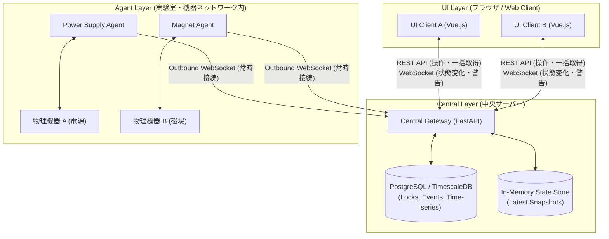
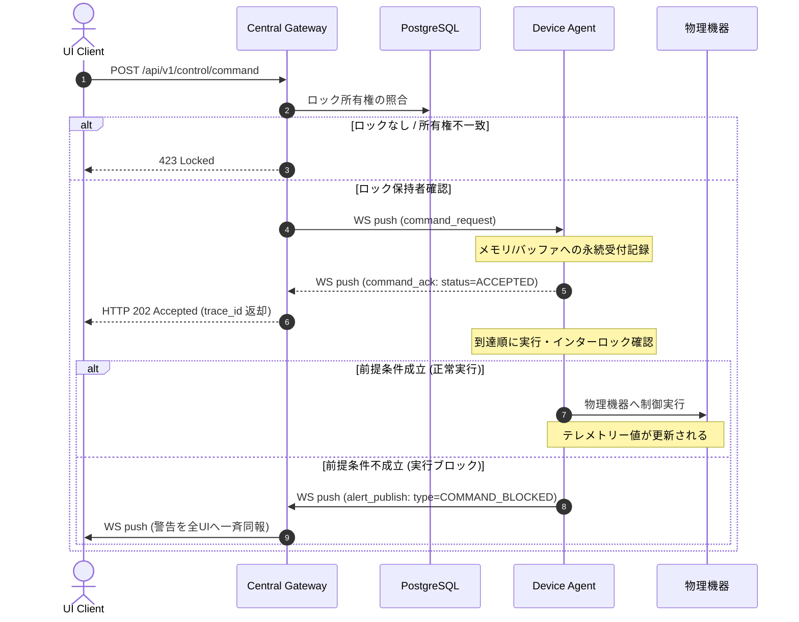
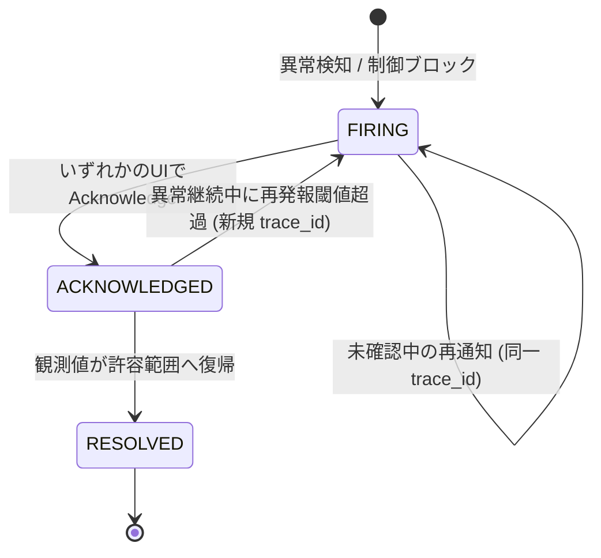

# Metis 通信規格仕様書（UI – Central – Agent）

**文書バージョン:** 1.0.0  
**制定日:** 2026-09-30  
**対象システム:** Metis 分散機器制御・監視フレームワーク  
**対象コンポーネント:**  
- **UI Layer:** Web Client (Vue.js / Vite SPA)  
- **Central Layer:** Central Gateway (FastAPI + PostgreSQL / TimescaleDB)  
- **Agent Layer:** Edge Device Agents (BaseAgent 派生 Python デーモン)  

---

## 目次
1. [システム全体アーキテクチャ・通信トポロジー](#1-システム全体アーキテクチャ通信トポロジー)
2. [共通メッセージプロトコル（Wire Protocol）](#2-共通メッセージプロトコルwire-protocol)
3. [排他制御（サブシステムロック）仕様](#3-排他制御サブシステムロック仕様)
4. [操作（Control / Command）仕様](#4-操作control--command仕様)
5. [監視（Monitoring / Telemetry）仕様](#5-監視monitoring--telemetry仕様)
6. [警告（Alert / Alarm）仕様](#6-警告alert--alarm仕様)
7. [REST API エンドポイント詳細定義](#7-rest-api-エンドポイント詳細定義)
8. [WebSocket メッセージ詳細定義](#8-websocket-メッセージ詳細定義)
9. [実装構成・ディレクトリ標準](#9-実装構成ディレクトリ標準)

---

## 1. システム全体アーキテクチャ・通信トポロジー



### 1.1 接続方式とネットワーク境界ルール
1. **Agent → Central（完全アウトバウンド接続）**
   - Agentは機器ネットワーク（NAT/ファイアウォール内部）からCentralの公開WebSocketエンドポイントへ能動接続（上り接続）を確立する。
   - CentralからAgentネットワークへのインバウンドポート開放・穴あけは一切不要とする。
   - 通信切断時は、Agentが指数バックオフ（Exponential Backoff: 初期値 1.0秒、最大 30.0秒）を用いて自動再接続を行う。
2. **UI → Central**
   - **操作（Control）**: HTTP POSTによるRPC型リクエスト。Centralを中継してAgentの永続受付を確認する。
   - **監視（Telemetry）**:
     - 定常ダッシュボード表示: HTTP GET によるサブシステム単位の「最新値一括スナップショット取得（REST）」。
     - リアルタイムイベント: 機器状態変化、接続切断、および取得停止状態をWebSocketで受信。
   - **警告（Alert）**: WebSocketを通じ、Centralに接続している全UIへ即時ブロードキャスト配信（Push）。

---

## 2. 共通メッセージプロトコル（Wire Protocol）

WebSocket上で送受信される全メッセージ、およびイベント配送は共通のエンベロープ（外枠）に格納する。

### 2.1 共通エンベロープスキーマ（MessageEnvelope）

```json
{
  "message_id": "UUIDv4 (個別メッセージの一意識別子)",
  "trace_id": "UUIDv4 | null (操作または警告シーケンスの追跡子)",
  "correlation_id": "UUIDv4 | null (リクエスト-レスポンスの紐付け用。応答時に要求元のmessage_idを設定)",
  "timestamp": "ISO8601 UTC (例: 2026-09-30T10:00:00.000Z)",
  "source": "string (送信元ノードID: 'ui-browser-01', 'agent-ps-01', 'central')",
  "destination": "string | null (宛先ノードID。Central宛またはブロードキャスト時はnull)",
  "type": "string (メッセージ種別)",
  "payload": { ... }
}
```

- **定期テレメトリー**: 帯域削減のため、定常テレメトリー配信時は `trace_id` および `correlation_id` を `null` とする。
- **操作シーケンス**: UIが発行した `trace_id` をAgentの受付・警告発生まで保持し、一連のログを追跡可能とする。

---

## 3. 排他制御（サブシステムロック）仕様

複数クライアント（UI/CLI）からの制御競合を防ぐため、Central＋PostgreSQLにより「サブシステム単位」での期限付きリースロックを行う。

### 3.1 ロック制御原則
1. **ロックの粒度**:
   - 装置単体ではなく、「電源系（`power_subsystem`）」「冷却系（`cooling_subsystem`）」といった論理サブシステム単位でロックを管理する。
2. **有効期限とリース更新**:
   - ロック取得時に有効期間（`lease_duration_sec`: デフォルト300秒）を指定する。
   - 有効期限が切れたロックは無効とみなされ、他者が即時取得可能となる（自動解放）。
3. **強制奪取（Force Override）**:
   - `force=true` を指定したリクエストは、既存の他者ロックを強制的に上書き奪取できる。
   - 強制奪取が発生した場合、Centralは `LOCK_EVENT (revoked)` を全接続UIへWebSocketブロードキャストし、前所有者の操作パネルを即時ロックする。

---

## 4. 操作（Control / Command）仕様

### 4.1 コマンド受付と非同期実行モデル
操作要求は「絶対値指定（Absolute Value）」に限定し、差分更新（Relative Step）は禁止する（パケット重複や再試行による過剰適用の防止）。



### 4.2 処理規則
1. **HTTP 202 受付終了**:
   - CentralはAgentから永続受付（`command_ack`）を受信した時点でUIへ **HTTP 202 Accepted** を返す。
   - これは「受付完了」の通知であり、「物理制御の完了」や「成功」を意味しない。
   - 制御完了の個別成功通知（UIへの完了メッセージ）は行わず、**「監視テレメトリーの値が設定値の許容範囲内に収まったか」**をUIおよびユーザーが確認する運用ルールとする。
2. **タイムアウト（HTTP 504）**:
   - CentralがAgentへコマンドを送信後、機器別設定時間（例: 3.0秒）以内に `command_ack` が返らない場合は **HTTP 504 Gateway Timeout** をUIへ返す。
   - 504返却時でも、Centralは自動再送を行わない（Agent側での遅延実行による多重実行事故を防ぐため）。
3. **到達順処理と割り込み**:
   - Agentはコマンドを「物理的到達順」で順次キューイング・処理する。UI側の送信タイムスタンプは順序判定には用いない。
   - 設定値変更の実行中であっても、オペレーターによる即時訂正を許容するため、最新の目標値書き換え要求を優先適用する（機器保護上の安全条件に抵触しない限りAgentが受付・上書きする）。
4. **実行不能・インターロック異常**:
   - 前提条件不成立やハードウェア異常により制御がブロックされた場合、Agentは即座に**警告（Alert）**を発報し、全UIへ同報通知する。

---

## 5. 監視（Monitoring / Telemetry）仕様

### 5.1 スナップショット取得と差分通知の二重構造
監視系はネットワークおよびブラウザの負荷を最小化するため、以下のハイブリッド構成をとる。

1. **定常ダッシュボード（REST スナップショット）**:
   - UIは定常ポーリング（1.0〜2.0秒周期）または画面切り替え時に `GET /api/v1/subsystems/{id}/snapshot` を実行する。
   - Centralのインメモリステート辞書から、対象サブシステムに属する全チャンネルの最新値が一括返却される。
2. **状態変化・切断（WebSocket イベント）**:
   - Agentのプロセス切断、取得状態の停止、および閾値逸脱イベントは、WebSocketを通じて即座に全UIへPush通知される。

### 5.2 keep-alive と取得状態（Acquisition State）の分離
Agentのプロセス稼働（Heartbeat）と、物理機器からの計測値取得可否を明確に分離して通知する。

| 状態コード | 意味 | Central / UI の挙動 |
|---|---|---|
| `ACQUIRING` | 正常に機器からデータ取得中 | 正常表示（グリーン） |
| `DEVICE_COMM_ERROR` | Agentは生存しているが機器通信エラー | 数値停止警告、リトライ表示（イエロー） |
| `AGENT_OFFLINE` | AgentとCentral間のWebSocketが切断 | 通信途絶警告、全項目無効化（レッド） |

### 5.3 Central 再起動時の復元シーケンス
1. Central起動時に一意の起動識別子 `central_instance_id` (UUIDv4) を発行する。
2. UIは接続時およびスナップショット取得時に `central_instance_id` を受信・照合する。
3. 前回値と異なる場合、UIは保持しているローカルキャッシュを破棄し、初期画面同期シーケンスを実行する。
4. Centralは起動直後に全Agentに対して `SYSTEM_STATE_FETCH_REQUEST` を発行し、全Agentから最新値を取得するまでUIへ旧キャッシュデータを返却しない。

---

## 6. 警告（Alert / Alarm）仕様

### 6.1 警告の配送と確認（Acknowledge）
- 警告は一切の欠落を許容しない重要データとして扱い、Central接続中の**全UIへブロードキャスト**する。
- 誰か1人のオペレーターがUI上で対象 `trace_id` を確認（Acknowledge）した時点で、Central側で `acknowledged=true` に更新され、全UIの画面上で確認済み状態が同期される。
- **Acknowledgeは「異常の認知」であり、「機器の物理的復旧」ではない。** 機器値が許容範囲に戻るまで監視および警告表示は維持される。



### 6.2 操作異常終了と警告の統合
操作コマンド（Command）が受付後に異常終了（インターロック等でブロック）した場合、リクエスト元UIへのみ個別エラーを返すのではなく、**同一の `trace_id` を保持した警告メッセージとして全UIへ同報する**。これにより、システム全体の状況を全オペレーターが即座に共有可能とする。

---

## 7. REST API エンドポイント詳細定義

### 7.1 排他制御 API

#### `POST /api/v1/control/lock`
サブシステムの操作ロックを取得・延長・強制奪取する。

- **リクエストヘッダー:** `Content-Type: application/json`
- **リクエストボディ:**
```json
{
  "subsystem_id": "power_subsystem",
  "client_id": "operator_tanaka",
  "lease_duration_sec": 300,
  "force": false
}
```
- **レスポンス:**
  - `200 OK`: ロック獲得成功
    ```json
    {
      "subsystem_id": "power_subsystem",
      "granted": true,
      "current_owner": "operator_tanaka",
      "expires_at": "2026-09-30T10:05:00.000Z",
      "reason": null
    }
    ```
  - `423 Locked`: 他者が排他的にロック中（`force=false` の場合）
    ```json
    {
      "subsystem_id": "power_subsystem",
      "granted": false,
      "current_owner": "operator_suzuki",
      "expires_at": "2026-09-30T10:02:15.000Z",
      "reason": "Locked by operator_suzuki"
    }
    ```

#### `POST /api/v1/control/unlock`
ロックを明示的に解放する（所有者のみ実行可能）。

- **リクエストボディ:**
```json
{
  "subsystem_id": "power_subsystem",
  "client_id": "operator_tanaka"
}
```
- **レスポンス:** `200 OK` (`{"released": true}`)

---

### 7.2 機器操作 API

#### `POST /api/v1/control/command`
対象機器に対する制御コマンドを発行する。

- **リクエストヘッダー:** `Content-Type: application/json`
- **リクエストボディ:**
```json
{
  "target_device": "ps_unit_01",
  "subsystem_id": "power_subsystem",
  "client_id": "operator_tanaka",
  "action": "set_voltage",
  "params": {
    "voltage": 12.50
  }
}
```
- **レスポンス:**
  - `202 Accepted`: Agentが要求を永続記録・受付完了
    ```json
    {
      "status": "ACCEPTED",
      "trace_id": "99998888-7777-6666-5555-444433332222",
      "message": "Command accepted by agent queue"
    }
    ```
  - `423 Locked`: ロック未保持またはロック失効
  - `504 Gateway Timeout`: Agentからの受付応答タイムアウト（再送は行わない）

---

### 7.3 監視・テレメトリー API

#### `GET /api/v1/subsystems/{subsystem_id}/snapshot`
対象サブシステムの全測定チャンネルの現在ステートを一括取得する。

- **レスポンス:** `200 OK`
```json
{
  "subsystem_id": "power_subsystem",
  "central_instance_id": "7f8b3c9a-4d2e-4b6a-9a8f-123456789abc",
  "timestamp": "2026-09-30T10:00:01.120Z",
  "status": "ok",
  "channels": {
    "voltage": {
      "value": 12.50,
      "unit": "V",
      "acquisition_state": "ACQUIRING"
    },
    "current": {
      "value": 1.452,
      "unit": "A",
      "acquisition_state": "ACQUIRING"
    },
    "temperature": {
      "value": 26.4,
      "unit": "degC",
      "acquisition_state": "ACQUIRING"
    },
    "output_state": {
      "value": true,
      "unit": null,
      "acquisition_state": "ACQUIRING"
    }
  }
}
```

---

### 7.4 警告 API

#### `POST /api/v1/alerts/{trace_id}/ack`
発生中の警告を認知・確認（Acknowledge）する。

- **リクエストボディ:**
```json
{
  "user_id": "operator_tanaka",
  "ui_id": "ui_browser_room_a"
}
```
- **レスポンス:** `200 OK` (`{"acknowledged": true, "trace_id": "..."}`)

---

## 8. WebSocket メッセージ詳細定義

Centralのエンドポイント `/ws/agent/connect?node_id={node_id}`（Agent用）および `/ws/client/events`（UI用）にて送受信されるJSONペイロードを規定する。

### 8.1 制御要求（Central → Agent: `command_request`）
```json
{
  "message_id": "11112222-3333-4444-5555-666677778888",
  "trace_id": "99998888-7777-6666-5555-444433332222",
  "correlation_id": null,
  "timestamp": "2026-09-30T10:00:00.000Z",
  "source": "central",
  "destination": "agent-ps-01",
  "type": "command_request",
  "payload": {
    "target_device": "ps_unit_01",
    "subsystem_id": "power_subsystem",
    "client_id": "operator_tanaka",
    "action": "set_voltage",
    "params": {
      "voltage": 12.50
    }
  }
}
```

### 8.2 受付確認応答（Agent → Central: `command_ack`）
```json
{
  "message_id": "22223333-4444-5555-6666-777788889999",
  "trace_id": "99998888-7777-6666-5555-444433332222",
  "correlation_id": "11112222-3333-4444-5555-666677778888",
  "timestamp": "2026-09-30T10:00:00.015Z",
  "source": "agent-ps-01",
  "destination": "central",
  "type": "command_ack",
  "payload": {
    "status": "ACCEPTED",
    "queued_index": 1,
    "error_code": null,
    "reason": null
  }
}
```

### 8.3 テレメトリーバルク送信（Agent → Central: `telemetry_publish`）
```json
{
  "message_id": "33334444-5555-6666-7777-888899990000",
  "trace_id": null,
  "correlation_id": null,
  "timestamp": "2026-09-30T10:00:01.000Z",
  "source": "agent-ps-01",
  "destination": null,
  "type": "telemetry_publish",
  "payload": {
    "source_device": "ps_unit_01",
    "subsystem_id": "power_subsystem",
    "acquisition_state": "ACQUIRING",
    "status": "ok",
    "metrics": [
      { "name": "voltage", "value": 12.498, "unit": "V" },
      { "name": "current", "value": 1.452, "unit": "A" },
      { "name": "temperature", "value": 26.5, "unit": "degC" },
      { "name": "output_state", "value": true, "unit": null }
    ]
  }
}
```

### 8.4 警告・異常通知（Agent/Central → 全UI: `alert_publish`）
```json
{
  "message_id": "44445555-6666-7777-8888-999900001111",
  "trace_id": "aaaa-bbbb-cccc-dddd-eeee",
  "correlation_id": null,
  "timestamp": "2026-09-30T10:00:02.000Z",
  "source": "agent-ps-01",
  "destination": null,
  "type": "alert_publish",
  "payload": {
    "alert_code": "INTERLOCK_TRIP_TEMP",
    "severity": "CRITICAL",
    "target_device": "ps_unit_01",
    "subsystem_id": "power_subsystem",
    "message": "PS unit temperature exceeded safety threshold (50 degC)",
    "related_command_trace_id": "99998888-7777-6666-5555-444433332222",
    "current_values": {
      "temperature": 52.3
    }
  }
}
```

---

## 9. 実装構成・ディレクトリ標準

フレームワークの実装リポジトリは以下のモジュール分割に準拠する。

```text
metis/
├── common/                     # 共通ライブラリ（Pythonパッケージ）
│   ├── __init__.py
│   └── schemas.py              # Pydantic v2 メッセージエンベロープ・ペイロード定義
├── central/                    # Central Gateway サービス
│   ├── main.py                 # FastAPI エントリーポイント
│   ├── lock_manager.py         # PostgreSQLトランザクション連携ロック調停
│   ├── state_store.py          # インメモリ最新スナップショット保持
│   └── ws_router.py            # WebSocketコネクション管理・同報ルーター
├── agent/                      # Agent Layer 実装
│   ├── base_agent.py           # 接続維持・自動再接続・送受信抽象基底クラス
│   └── devices/
│       ├── power_supply.py     # 電源装置用具象Agent
│       └── magnet.py           # 磁場制御用具象Agent
└── frontend/                   # UI Layer (Vue 3 + Vite)
    ├── package.json
    ├── src/
    │   ├── App.vue             # ダッシュボード・操作コンソール
    │   ├── stores/             # 状態管理（Pinia）
    │   └── services/           # REST API & WebSocket クライアント
    └── vite.config.js
```