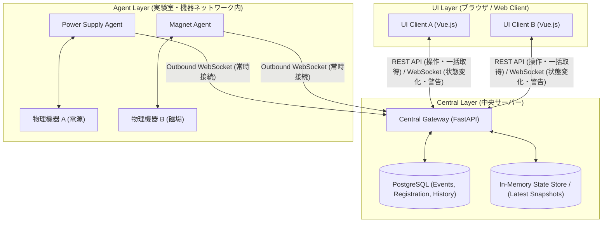
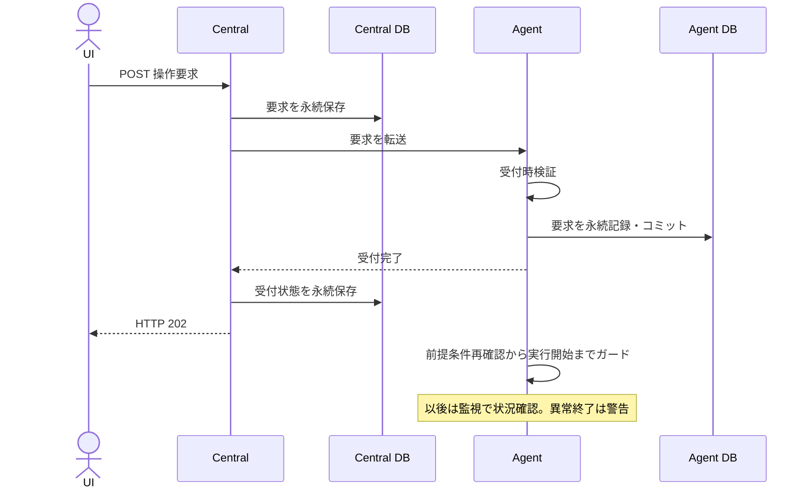

# Metis 通信規格仕様書（UI – Central – Agent）

**文書バージョン:** 1.0.2（合意事項再照合版）  
**制定日:** 2026-09-30  
**更新日:** 2026-10-01  
**対象システム:** Metis 分散機器制御・監視フレームワーク  
**対象コンポーネント:**  
- **UI Layer:** Web Client (Vue.js、Viteは実装候補)  
- **Central Layer:** Central Gateway (FastAPI + Pydantic + SQLAlchemy + PostgreSQL)  
- **Agent Layer:** Edge Device Agents (Python、ローカル永続保存 SQLite)  

## 文書の読み方

本書は合意済み方針を仕様として整理した改訂版である。具体的な実装選択のうち、議論で未承認のものは **【要注意：採否確認】**、詳細が決まっていないものは **【未決定】** と表示する。要注意のAPI・JSON例は実装案であり、確定仕様として扱わない。

FastAPI、Pydantic、SQLAlchemy、PostgreSQL、Agent側SQLiteは保存方針文書に基づく。Vueは採用方針。TimescaleDB、Piniaなどの追加選択は未確定。GenericAgent等のクラス構成は実装例であり、通信規格の必須条件ではない。

本版は1.0.1を基準とし、後述§12の根拠資料と会話上の決定を照合して補完した。後の文書で単に「未決定」と記されたことを、先行する明示決定の撤回とはみなさない。撤回・変更が確認できない合意は保持し、競合する提案や不明な詳細は未決定として残す。

---

## 目次

1. [システム全体アーキテクチャ・通信トポロジー](#1-システム全体アーキテクチャ通信トポロジー)
2. [共通メッセージプロトコル（Wire Protocol）](#2-共通メッセージプロトコルwire-protocol)
3. 操作の競合処理とUI接続管理
4. [操作（Control / Command）仕様](#4-操作control--command仕様)
5. [監視（Monitoring / Telemetry）仕様](#5-監視monitoring--telemetry仕様)
6. [警告（Alert / Alarm）仕様](#6-警告alert--alarm仕様)
7. [REST API エンドポイント詳細定義](#7-rest-api-エンドポイント詳細定義)
8. [WebSocket メッセージ詳細定義](#8-websocket-メッセージ詳細定義)
9. [実装構成・ディレクトリ標準](#9-実装構成ディレクトリ標準)
10. 要注意事項と未決定事項
11. データ保存・保存不能時の規則
12. 照合資料と変更履歴

---

## 1. システム全体アーキテクチャ・通信トポロジー



### 1.1 接続方式とネットワーク境界ルール

**【要注意：採否確認】** REST／WebSocketの使い分け、Agentの完全アウトバウンド接続、バックオフ1〜30秒は新規実装案。通信方式と保存構成は分けて扱う。DBと最新値メモリ保持の採用は§11を参照。以下のWebSocket経路は実装候補であり、操作POSTの方針、配信対象、保存責任とは区別する。

1. **Agent → Central（完全アウトバウンド接続）**
   - Agentは機器ネットワーク（NAT/ファイアウォール内部）からCentralの公開WebSocketエンドポイントへ能動接続（上り接続）を確立する。
   - CentralからAgentネットワークへのインバウンドポート開放・穴あけは一切不要とする。
   - 通信切断時は、Agentが指数バックオフ（Exponential Backoff: 初期値 1.0秒、最大 30.0秒）を用いて自動再接続を行う。
2. **UI → Central**
   - **操作（Control）**: HTTP POSTによるRPC型リクエスト。Centralを中継してAgentの永続受付を確認する。
   - **監視（Telemetry）**:
     - 接続成立時にCentralが保持する全監視対象の最新値をUIへ配信する。
     - 接続後は値の変化時に全UIへ配信し、表示対象のフィルタリングはUI内で行う。Central側の購読条件登録は行わない。
     - Agentのkeep-aliveに含まれる取得状態もCentralからUIへ伝える。
     - RESTスナップショットは補助的な取得手段の候補とし、定期ポーリングを主経路にしない。
   - **警告（Alert）**: WebSocketを通じ、Centralに接続している全UIへ即時ブロードキャスト配信（Push）。

---

## 2. 共通メッセージプロトコル（Wire Protocol）

通信単位はヘッダーとペイロードを持つメッセージである。以下は共通エンベロープの実装案であり、全タイプに全項目を必須とする意味ではない。

### 2.1 共通エンベロープスキーマ（MessageEnvelope）

**【要注意：採否確認】** UUIDv4、ISO8601 UTC、source／destination、type、correlation_id、および以下の具体的キー名は実装案。ヘッダーはアプリケーションの共通情報でありHTTPヘッダーに限定しない。

```json
{
  "message_id": "UUIDv4 | omitted (操作・警告では使用、定期監視では任意)",
  "trace_id": "UUIDv4 | null (操作または警告シーケンスの追跡子)",
  "correlation_id": "UUIDv4 | null (リクエスト-レスポンスの紐付け用。応答時に要求元のmessage_idを設定)",
  "timestamp": "ISO8601 UTC (例: 2026-09-30T10:00:00.000Z)",
  "source": "string (送信元ノードID: 'ui-browser-01', 'agent-ps-01', 'central')",
  "destination": "string | null (宛先ノードID。Central宛またはブロードキャスト時はnull)",
  "type": "string (メッセージ種別)",
  "payload": {}
}
```

- **定期テレメトリー**: `trace_id` と `message_id` は必須としない。省略／nullの表現や `correlation_id` の採否は未決定。タイプと送信開始直前の時刻はヘッダーに必須。
- **操作シーケンス**: 操作の `trace_id` はCentralと一つのAgentの一制御を識別する。Centralが割り当て、Central→Agent→Centralで維持する。UIによる発行・保持や個別結果照会APIは必須としない。具体的なID形式・生成方法は未決定。
- **警告シーケンス**: 警告の `trace_id` は発報からacknowledgeまでを識別する。操作IDとの関連付け方法は未決定。後述の例では別の警告IDと `related_command_trace_id` を用いる案を示す。
- **複数Agent処理**: `workflow_id` により関連付ける。全体と各Agentのtraceの親子関係を保持する。発行方法・具体的な配置、全体の成否・途中失敗時の扱いは未決定。
- **経由記録**: 経由サービス一覧をメッセージに逐次追加せず、各段階の記録を共通識別子で関連付ける。

### 2.2 共通項目と個別項目

| 項目 | 操作 | 監視 | 警告 |
|---|---|---|---|
| message_id／trace_id | 使用 | 必須としない | 使用 |
| タイプ | 具体形式は未決定 | ヘッダーに必須 | 具体形式は未決定 |
| 送信時刻 | ヘッダーに含める | ヘッダーに必須。送信開始直前の時刻 | ヘッダーに必須。送信開始直前の時刻 |
| 機器ID・操作名 | Central–Agentのヘッダーに含める | 対象識別方法は未決定 | 異常対象・関連操作の配置は未決定 |
| ユーザーID・UI識別子 | Central→Agent要求ヘッダー。応答では省略し記録を参照 | 一律に要求しない | 確認者・確認元の配置は未決定 |
| workflow_id | 複数Agent処理で使用 | 必須としない | 関連付けは未決定 |
| 通知トライ回数 | 未決定 | 必須としない | Agent初回0、再発信ごとに増加。配置未決定 |
| 異常検知時刻 | — | — | 現traceの最初の異常検知時刻をペイロードに保持 |

具体的なJSONキーとUI–Centralでの対応形式は要注意の実装案とする。機器固有の操作内容をペイロードに置く。警告のIDの配置は未決定。

`workflow-id`（複数Agentの全体）→`trace-id`（一制御または警告の流れ）→`message-id`（個々の通信）という役割を区別する。workflowで警告traceも束ねるかは未決定であり、この階層説明を全警告へのworkflow必須化と解釈しない。`operation_id`／`group_id`という名称や、独立した`request_id`の追加は合意済み仕様ではない。直近実装例の`request_id`を既存traceの代わりに導入したことは仕様の変更決定と扱わない。

### 2.3 Agent登録と履歴

Agent登録時に操作名・スキーマをCentralでグローバルに保持し、更新時刻と旧版履歴をデータベースに記録する。制御記録にスキーマ版や登録履歴への参照は残さず、必要時に追加する。登録API、通信規格版の表現、履歴保存期間は未決定。過去の制御は記録時刻とスキーマ履歴を突き合わせて解釈する。更新境界付近で適用版を確定できない場合を許容する。

### 2.4 認証された発信元とUI識別

- Centralは認証済みUI要求からユーザーIDを確定する。本文の自己申告をそのまま信用しない。
- UI識別子はブラウザー画面ごとに発行し、ネットワークアドレス、ブラウザー種類、ユーザーIDと組にしてDBへ記録する。プロキシ経由のアドレスが端末アドレスとは限らない。
- Agent IDは認証済み接続または認証済み要求から確定する。Agent IDを本文に含める場合も認証結果との一致を検証し、受信記録に関連付ける。
- テレメトリーでAgent IDをメッセージに必須とはしない。HTTP接続の再利用だけでは要求の認証を代替しない。
- 認証方式、ID形式、UI登録API、保持期間は未決定。現在のhello_metis実装例にはこれらの認証・保存処理は未実装。

---

## 3. 操作の競合処理とUI接続管理

- 複数ユーザーからの同時操作を許可する。Centralの排他的な所有権ロックを操作の必須条件にはしない。
- Agentへの到達順で処理し、許可される新しい目標値を有効とする。
- 実行前提条件の確認から実行開始までをAgentでガードし、この区間への割り込みを防ぐ。
- ガードは制御完了まで後続要求を一律に待たせるものではない。制御中の目標値変更はAgentが機器固有条件で許可・ブロックを判断する。
- ブラウザーのkeep-aliveと閉鎖時失効を採用する。閉鎖時に失効記録を試み、通知が届かなくてもkeep-alive停止と期限切れから失効を判断する。**【未決定】** 失効対象、周期・期限、受付済み操作への影響。サブシステムロックのリースとは同一視しない。

---

## 4. 操作（Control / Command）仕様

### 4.1 コマンド受付と非同期実行モデル

値の更新は「絶対値指定（Absolute Value）」とし、差分更新（Relative Step）は禁止する。測定開始・リセット等も操作として扱う。絶対値指定は重複要求による値の累積を防ぐが、処理そのものの重複実行を一律に防ぐ保証ではない。



保存失敗時の分岐は§11.4に従う。DB保存前に受付成功を返す意味ではない。Agentの実行開始はUIの202受信を待つ条件ではなく、図の後段は論理的な処理区分を示す。

### 4.2 処理規則

1. **HTTP 202 受付終了**:
   - Agentは形式・対象・操作・受付時に確認できる条件を検証し、適合する要求を永続記録・コミットして受付完了とする。UIでの検証は代替にならない。実行時条件は再確認する。
   - Centralは要求保存後に転送し、Agentの永続受付確認後に受付状態を保存してUIへ **HTTP 202 Accepted** を返す（§11）。
   - これは「受付完了」の通知であり、「物理制御の完了」や「成功」を意味しない。
   - 制御完了の個別成功通知（UIへの完了メッセージ）は行わず、**「監視テレメトリーの値が設定値の許容範囲内に収まったか」**をUIおよびユーザーが確認する運用ルールとする。
2. **タイムアウト（HTTP 504）**:
   - CentralがAgentへコマンドを送信後、機器別設定時間（**【要注意：採否確認】** 例示値3.0秒）以内に、受付応答または同traceの受付記録照会で受付の有無を確認できない場合は **HTTP 504 Gateway Timeout** をUIへ返す。
   - 504返却時でも自動再送を行わない。Centralは「受付未確認」の記録を保持する。504は操作失敗・未実行の保証ではない。
   - 受付応答が速やかに届かなければ、同じtrace_idの受付記録をAgentのAPIで照会する。期限内に受付済みを確認できれば、受付状態を保存して202を返す。照会は操作の再送ではない。照会APIと具体的な待機・照会タイミングは未決定。
   - ユーザー設定の待機期限に管理者上限を設ける。操作成功の判定期限とは別である。具体的な設定方法・数値は未決定。
3. **到達順処理と割り込み**:
   - Agentはコマンドを到達順で処理する。UI側の送信タイムスタンプは順序判定には用いない。
   - 前提条件確認から実行開始までをガードする。先行操作の物理的完了まで後続の目標値変更を待たせる意味ではない。
   - 設定値変更の実行中であっても、オペレーターによる即時訂正を許容するため、到達順に新しい目標値書き換え要求を適用する（機器保護上の安全条件に抵触しない限りAgentが受付・上書きする）。
4. **反復操作と実行不能**:
   - 測定開始・リセット等も操作として扱う。差分値更新の禁止はこれらの操作を禁止する意味ではない。
   - 二つ目の操作も永続受付し、反復の前提条件を満たさない場合は実行をブロックして異常終了とする。
   - 受付前の拒否には共通形式の理由を返す。コード・説明・機器固有詳細の具体的な形式は未決定。
   - 前提条件不成立やハードウェア異常により制御がブロックされた場合、Agentは即座に**警告（Alert）**を発報し、全UIへ同報通知する。

---

### 4.3 Agent側の状態管理とUI通知の区別

| 状態 | 意味 |
|---|---|
| 受付未確認 | CentralがAgentの受付の有無を確認できていない |
| 受付完了 | 受付時検証と要求の永続記録が完了 |
| 処理中 | 受付後の処理。キュー内の待機も含み、待機中を別状態にしない |
| 成功 | 機器別の期限と方法により要求状態への変更を確認した事実 |
| 失敗 | 明確な拒否・エラー、または期限内未達を観測した事実。理由を記録 |
| 結果不明 | 機器に命令が届いた可能性があり、通信断等で結果を判定できない |

先行するCentral–Agentの状態管理を、UIへの個別成功通知に読み替えない。後の合意は「UIの操作応答は受付で終了、以後は監視、異常は警告」である。成功の観測・記録と成功の保証も区別する。機器別の許容差・安定時間・期限・判定方法は参照可能にし、後から判明した状態も事実として記録する。これらの状態の具体的な通知形式は未決定。

---

## 5. 監視（Monitoring / Telemetry）仕様

### 5.1 最新値と変更値の配信

1. 接続成立時（初回・再接続）には全監視対象の最新値を配信する。
2. 接続後は値の変化時に全UIへ配信し、UI内で表示をフィルタリングする。
3. Agentの取得周期・Agent→Centralの値送信周期を、このUI向け配信条件と同じとは規定しない。
4. 取得停止をUIへ伝える。値の不変と取得停止を区別する。
5. 監視は途中の欠落を許容し、切断中の全更新履歴ではなく最新状態で復元する。
6. **【要注意：採否確認】** RESTによるスナップショット取得は補助手段の候補。取得対象の切り替えは全UI配信を制限しない。

### 5.1.1 正常性の判断

| 設定値と観測値 | 状態 | 判断 |
|---|---|---|
| 差が許容範囲内 | 任意 | 正常 |
| 差が許容範囲外 | 状態変化中 | この差だけでは異常としない |
| 差が許容範囲外 | 状態変化中でない | 異常 |

要求値への到達や成功は保証しない。制御中の更新をUIが受信しなくても現在の設定値・観測値が許容範囲内なら問題ない。未取得・取得停止は数値比較による正常判断と別に表示する。

### 5.1.2 テレメトリーのヘッダーと鮮度

ヘッダーにはタイプと送信開始直前の時刻を必須とする。測定値と測定時刻はペイロードの内容として扱い、測定時刻を送信時刻で上書きしない。Central受信時刻・DB保存時刻とも区別する。測定時刻の具体構造・必須性は未決定。

Agent IDだけでは複数機器・チャンネルの測定対象を区別できない。対象と測定時刻を解釈し、遅れた情報を現在値と誤認させない。対象階層、順序番号、時計ずれへの対応など具体的な鮮度判定は未決定。IDを任意とすることは鮮度・順序の対策を不要にしない。

UI配信、Agent取得、Centralでの履歴保存は別の周期・条件である。変更時＋一定周期の履歴保存と無期限保存は§11.3に従う。

### 5.2 keep-alive と取得状態（Acquisition State）の分離

Agentのkeep-aliveに取得状態を含め、Agent→Central→UIへ伝える。生存していても取得停止している場合を判別する。

**【要注意：採否確認】** 以下の状態コード・色・UIの全項目無効化は新規案。**【未決定】** 対象粒度、keep-alive周期、欠落判定期限、取得復旧の通知形式。

| 状態コード | 意味 | Central / UI の挙動 |
|---|---|---|
| `ACQUIRING` | 正常に機器からデータ取得中 | 正常表示（グリーン） |
| `DEVICE_COMM_ERROR` | Agentは生存しているが機器通信エラー | 数値停止警告、リトライ表示（イエロー） |
| `AGENT_OFFLINE` | AgentとCentral間のWebSocketが切断 | 通信途絶警告、全項目無効化（レッド） |

### 5.3 Central 再起動時の復元シーケンス

1. Central起動時に一意の起動識別子 `central_instance_id` (UUIDv4) を発行する。
2. UIは接続時およびスナップショット取得時に `central_instance_id` を受信・照合する。
3. 前回値と異なる場合、UIは保持しているローカルキャッシュを破棄し、初期画面同期シーケンスを実行する。
4. Centralは起動処理として全Agentに最新情報取得を要求する。UIの要求を待たない。
5. 取得できた情報から順次UIへ提供し、未取得対象を明示する。一台の無応答で全体の提供を待たせない。
6. 旧保存値は再取得前に最新情報として扱わない。
7. 同じ起動識別子ならCentralは稼働継続しており、保持する最新値でUIを復元する。通信断時点で停止原因をUIだけから断定しない。

**【要注意：採否確認】** 起動識別子のUUIDv4形式、UIキャッシュ破棄手順、`SYSTEM_STATE_FETCH_REQUEST` の具体名は実装案。

---

## 6. 警告（Alert / Alarm）仕様

### 6.1 警告の配送と確認（Acknowledge）

警告は欠落を許容しない重要情報として扱い、接続中の全UIへ配送する。保存・確認と配送は次の規則に従う。保存不能時は§11.4の例外方針を適用し、保存できていないのに保存確認を返さない。

1. Agentは異常検知時にtrace_idと異常検知時刻を記録し、送信前に警告を永続保存する。通信断中も保存可能な限り保持する。
2. Agentは各送信開始直前にヘッダーの送信時刻を設定する。配送失敗もDBに逐次記録する。
3. 同じ警告を再び送る場合、trace_idを維持し、新しいmessage_idを発行する。異常検知時刻は維持する。
4. Centralは受信ごとにAgent IDとtrace_idの組で照合し、警告を二重登録せず、確認済みを未確認へ戻さない。確認済みならAgentへその状態を伝える。
5. CentralはDB保存確定後に保存確認を返す。警告本体と配信待ち記録はoutbox方式で同一トランザクションに保存する（§11.2）。
6. Agentは保存確認を受け取った警告の「未同期用記録」を削除する。確認が届かなければ保持する。接続復旧時はCentralがAgentに残る警告を照会して取り込む。
7. 保存確認後もAgentはユーザー確認を待つtrace_idと確認待ち状態を保持する。Centralとの一時的な二重保持を許容する。
8. ログイン可能な任意のユーザー一人がUIから対象の確認APIを操作し、Centralは確認者・確認時刻・対象trace_idをDBに確定記録してAgentへ通知する。全員の確認は要求しない。
9. Agentはユーザー確認が伝わった時点で確認待ち状態を終了する。通知紛失時は復旧後に照合し、同じ警告の再受信時にもCentralが確認済みを返す。

**DB保存確認は未同期用記録の削除条件、ユーザー確認通知は確認待ち状態の終了条件である。** UIへの送信、UI表示、ユーザー確認、異常の解消も別の事実として扱う。

警告とacknowledgeの履歴を閲覧可能とする。ユーザーは警告を無視せず、異常を改善して確認する運用責任を持つが、確認操作は測定値の正常化を証明しない。未確認のまま異常が復旧しても自動的に確認済みとはしない。Agentは監視を継続し、確認後も異常条件が満たされれば新しいtrace_idで新しい警告を発する。いったん正常に戻ることを再発報の条件にしない。

**【未決定】** 確認APIの受理応答、重複確認の応答、確認通知の受領応答、同期の具体形式、再通知間隔・上限、復旧時に取り込む過去警告の能動通知方針。全UIへの即時確認済み同期や復旧まで表示を残すUI動作も未確定。

### 6.1.1 通知トライ回数と時刻

| 項目 | 決定済みの意味 |
|---|---|
| Agentの通知トライ回数 | 初回0。同じ警告をAgentが改めて発するたび、理由を問わず1増加 |
| 配送失敗後の再発信 | 同じtrace_id、新しいmessage_id、増加したトライ回数 |
| 未確認のための再通知 | 同じtrace_id、新しいmessage_id、増加したトライ回数 |
| 確認後の新規発報 | 新しいtrace_id。新しい警告の初回は0 |
| 送信時刻 | 各メッセージの送信開始直前。ヘッダーに置く |
| 異常検知時刻 | 現traceの最初の異常検知時刻。ペイロードに置き再発信でも維持 |

配送失敗と未確認による再通知の理由は記録上区別するが、決定済みのAgent通知トライ回数は両方で増える。Central→UI・メールの配送回数はこのカウンターに含めず、別途配送記録で扱う。IDとトライ回数の具体配置は未決定。同じ物理異常に由来する複数traceの関連付け方法も未決定。

### 6.2 操作異常終了と警告の統合

操作コマンド（Command）が受付後に異常終了（インターロック等でブロック）した場合、リクエスト元UIへのみ個別エラーを返すのではなく、**警告メッセージとして全UIへ同報する**。これにより、システム全体の状況を共有する。

**【要注意：採否確認】** 操作と警告に別のtrace_idを割り当て、`related_command_trace_id` で関連付ける案を§8.4に示す。両者の関連付けは未決定であり、操作IDを警告IDに流用する仕様は確定しない。

---

## 7. REST API エンドポイント詳細定義

### 7.1 API例の位置付け

**【要注意：採否確認】** 以下のAPIパス、具体的キー名、200応答、REST／WebSocket振り分けは実装候補。202／504の受付応答方針は合意済み。排他ロック取得・解除APIは操作の必須仕様から除外した。

### 7.2 機器操作 API

#### `POST /api/v1/control/command`

対象機器に対する制御コマンドを発行する。例のuser_idは識別説明用であり、実際の権限・記録上のユーザーIDは認証から確定する。

- **リクエストヘッダー:** `Content-Type: application/json`
- **リクエストボディ:**
```json
{
  "target_device": "ps_unit_01",
  "subsystem_id": "power_subsystem",
  "user_id": "operator_tanaka",
  "ui_id": "ui_browser_room_a",
  "action": "set_voltage",
  "params": {
    "voltage": 12.50
  }
}
```
- **レスポンス:**
  - `202 Accepted`: Agentが要求を永続記録・受付完了
    ```json
    {
      "status": "ACCEPTED",
      "trace_id": "99998888-7777-4666-8555-444433332222",
      "message": "Command accepted by agent queue"
    }
    ```
  - `504 Gateway Timeout`: Agent受付未確認。記録を保持し、自動再送しない。応答ボディ候補:
    ```json
    {"status": "ACCEPTANCE_UNCONFIRMED", "trace_id": "99998888-7777-4666-8555-444433332222"}
    ```
  - 受付前の拒否: 共通理由形式を使用する。HTTPコードと具体的ペイロードは未決定。

---

### 7.3 監視・テレメトリー API

#### `GET /api/v1/subsystems/{subsystem_id}/snapshot`

対象サブシステムの全測定チャンネルの現在ステートを一括取得する。

- **レスポンス:** `200 OK`
```json
{
  "subsystem_id": "power_subsystem",
  "central_instance_id": "7f8b3c9a-4d2e-4b6a-9a8f-123456789abc",
  "timestamp": "2026-09-30T10:00:01.120Z",
  "unacquired_targets": ["ps_unit_02"],
  "status": "ok",
  "channels": {
    "ps_unit_01.voltage": {
      "setpoint": 12.50,
      "observed_value": 12.498,
      "transitioning": false,
      "tolerance": 0.01,
      "acquired_at": "2026-09-30T10:00:01.000Z",
      "unit": "V",
      "acquisition_state": "ACQUIRING"
    },
    "ps_unit_01.current": {
      "value": 1.452,
      "unit": "A",
      "acquisition_state": "ACQUIRING"
    },
    "ps_unit_01.temperature": {
      "value": 26.4,
      "unit": "degC",
      "acquisition_state": "ACQUIRING"
    },
    "ps_unit_01.output_state": {
      "value": true,
      "unit": null,
      "acquisition_state": "ACQUIRING"
    }
  }
}
```

---

### 7.4 警告 API

#### `POST /api/v1/alerts/{trace_id}/ack`

発生中の警告を認知・確認（Acknowledge）する。確認者は認証結果から確定する。Agent IDとtrace_idの照合関係を失わない対象指定が必要であり、以下の単独trace_idパスの適用条件・具体形式は未確定。

- **リクエストボディ:**
```json
{
  "user_id": "operator_tanaka",
  "ui_id": "ui_browser_room_a"
}
```
- **レスポンス:** `200 OK` (`{"acknowledged": true, "trace_id": "..."}`)

### 7.5 警告・確認履歴

警告とacknowledgeの履歴を閲覧可能にする。**【未決定】** 閲覧API、保存期間、検索条件、具体的項目。確認者・確認時刻・対象trace_idの記録は決定済み。具体スキーマ、UI情報・関連操作IDの配置等は未決定。

---

## 8. WebSocket メッセージ詳細定義

**【要注意：採否確認】** 以下のエンドポイント、イベント名、JSONキーは実装案。Centralのエンドポイント `/ws/agent/connect?node_id={node_id}`（Agent用）および `/ws/client/events`（UI用）にて送受信されるJSONペイロードを規定する。

### 8.1 制御要求（Central → Agent: `command_request`）

```json
{
  "message_id": "11112222-3333-4444-5555-666677778888",
  "trace_id": "99998888-7777-4666-8555-444433332222",
  "correlation_id": null,
  "timestamp": "2026-09-30T10:00:00.000Z",
  "source": "central",
  "destination": "agent-ps-01",
  "type": "command_request",
  "target_device": "ps_unit_01",
  "action": "set_voltage",
  "user_id": "operator_tanaka",
  "ui_id": "ui_browser_room_a",
  "workflow_id": null,
  "payload": {
    "params": {
      "voltage": 12.50
    }
  }
}
```

機器ID・操作名・ユーザーID・UI識別子は共通ヘッダー情報として外枠に置き、機器固有パラメータのみペイロードに置く。workflow_idの配置は候補。UI–Centralの要求形式との変換は未決定。操作traceはCentralが割り当てる。

### 8.2 受付確認応答（Agent → Central: `command_ack`）

```json
{
  "message_id": "22223333-4444-5555-6666-777788889999",
  "trace_id": "99998888-7777-4666-8555-444433332222",
  "correlation_id": "11112222-3333-4444-5555-666677778888",
  "timestamp": "2026-09-30T10:00:00.015Z",
  "source": "agent-ps-01",
  "destination": "central",
  "type": "command_ack",
  "payload": {
    "status": "ACCEPTED",
    "queued_index": 1,
    "error_code": null,
    "reason": null
  }
}
```

### 8.3 テレメトリーバルク送信（Agent → Central: `telemetry_publish`）

```json
{
  "message_id": "33334444-5555-6666-7777-888899990000",
  "trace_id": null,
  "correlation_id": null,
  "timestamp": "2026-09-30T10:00:01.000Z",
  "source": "agent-ps-01",
  "destination": null,
  "type": "telemetry_publish",
  "payload": {
    "source_device": "ps_unit_01",
    "subsystem_id": "power_subsystem",
    "acquisition_state": "ACQUIRING",
    "status": "ok",
    "metrics": [
      { "name": "voltage", "value": 12.498, "unit": "V" },
      { "name": "current", "value": 1.452, "unit": "A" },
      { "name": "temperature", "value": 26.5, "unit": "degC" },
      { "name": "output_state", "value": true, "unit": null }
    ]
  }
}
```

### 8.4 警告・異常通知（Agent/Central → 全UI: `alert_publish`）

```json
{
  "message_id": "44445555-6666-7777-8888-999900001111",
  "trace_id": "aaaa0000-bbbb-4ccc-8ddd-eeee00000000",
  "correlation_id": null,
  "timestamp": "2026-09-30T10:00:02.000Z",
  "source": "agent-ps-01",
  "destination": null,
  "type": "alert_publish",
  "payload": {
    "alert_code": "INTERLOCK_TRIP_TEMP",
    "severity": "CRITICAL",
    "target_device": "ps_unit_01",
    "subsystem_id": "power_subsystem",
    "message": "PS unit temperature exceeded safety threshold (50 degC)",
    "related_command_trace_id": "99998888-7777-4666-8555-444433332222",
    "detected_at": "2026-09-30T10:00:01.800Z",
    "notification_attempt": 0,
    "current_values": {
      "temperature": 52.3
    }
  }
}
```

上例のdetected_atは現traceの初回異常検知時刻、notification_attemptはAgent初回0の例。キー名とトライ回数のペイロード配置は候補。警告のAgent→Central引き渡しとCentral→全UIの配信は別の配送段階であり、共通の一送信とはみなさない。

### 8.5 keep-alive（Agent → Central → UI）

取得状態を含むkeep-aliveをCentral経由でUIへ伝える。**【要注意：採否確認】** 以下の形式・コードは候補。

```json
{
  "type": "agent_keep_alive",
  "source": "agent-ps-01",
  "timestamp": "2026-09-30T10:00:03.000Z",
  "payload": {
    "targets": {
      "ps_unit_01": {
        "acquisition_state": "ACQUIRING",
        "last_acquired_at": "2026-09-30T10:00:02.900Z"
      }
    }
  }
}
```

Centralが検出するAgent接続断は、Agent自身から送れないためCentralがUIへ伝える。判定期限とメッセージ形式は未決定。

### 8.6 最新値・変更値のUI配信

接続時は全対象の最新値と未取得対象を配信する。その後は変更値と取得状態を全UIへ配信する。**【未決定】** `snapshot_publish`／`telemetry_update`等の種別、取得時刻・順序番号、一括取得と後続更新の順序管理、分割配信。

### 8.7 ペイロードの検討候補

| 種類 | 検討項目 |
|---|---|
| 操作要求 | 絶対目標値・固有パラメータ、単位・範囲・登録スキーマとの対応 |
| 受付・拒否 | 受付状態・時刻、理由コード・説明・固有詳細、受付未確認の照会情報 |
| 監視 | 設定値・観測値・状態変化中、許容範囲、取得時刻、取得済み／未取得、更新順序 |
| keep-alive | 対象別取得状態・最終取得時刻。周期・期限と状態粒度 |
| 警告 | 内容・異常対象・発報時の値、現traceの異常検知時刻、Agent通知トライ回数。意味と時刻配置は§6.1.1で決定済み |
| 確認・履歴 | 対象trace_id、確認者・時刻・UI、配送試行・UI表示の記録、関連操作ID |

値の配信閾値と正常判定の許容範囲は別概念。Agentの通知トライ回数とCentral側の配送記録も区別する。具体的な配置・型・必須性の未決定部分は§2・§6に従い、決定済み項目を未決定に戻さない。

---

## 9. 実装構成・ディレクトリ標準

**【要注意：採否確認】** 以下は新規の実装構成案であり、通信規格への準拠条件ではない。PydanticとDBの採用は§11に従う。Pinia等は未確定。以下は旧構成案の参考であり、実装中のbackend/src/metis、ui、docs構成を禁止しない。

```text
metis/
├── common/                     # 共通ライブラリ（Pythonパッケージ）
│   ├── __init__.py
│   └── schemas.py              # Pydantic v2 メッセージエンベロープ・ペイロード定義
├── central/                    # Central Gateway サービス
│   ├── main.py                 # FastAPI エントリーポイント
│   ├── registration_store.py   # Agent登録・操作スキーマ・旧版履歴
│   ├── state_store.py          # インメモリ最新スナップショット保持
│   └── ws_router.py            # WebSocketコネクション管理・同報ルーター
├── agent/                      # Agent Layer 実装
│   ├── base_agent.py           # 接続維持・自動再接続・送受信抽象基底クラス
│   └── devices/
│       ├── power_supply.py     # 電源装置用具象Agent
│       └── magnet.py           # 磁場制御用具象Agent
└── frontend/                   # UI Layer (Vue 3 + Vite)
    ├── package.json
    ├── src/
    │   ├── App.vue             # ダッシュボード・操作コンソール
    │   ├── stores/             # 状態管理（Pinia）
    │   └── services/           # REST API & WebSocket クライアント
    └── vite.config.js
```

## 10. 要注意事項と未決定事項の一覧

| 区分 | 項目 |
|---|---|
| 実装候補 | Outbound WebSocketへの統一、REST補助取得、バックオフ値、UUIDv4、correlation_id、エンベロープの具体形式 |
| 実装候補 | 状態コード・色・重大度、確認済みの即時同期、警告表示の終了条件、操作traceと警告traceの関連付け |
| 未決定 | workflow_idの発行方法・配置・全体の成否・途中失敗、ID形式、拒否理由コード、HTTP拒否応答 |
| 未決定 | ブラウザー失効の作用範囲と受付済み操作への影響、keep-alive周期・粒度・期限 |
| 未決定 | 受付記録照会API・タイミング、再起動後の受付済み操作の扱い、自動再実行を避ける復旧手順 |
| 未決定 | 監視の変化判定、鮮度・時計ずれ・順序管理、接続時スナップショットと後続更新の整合 |
| 未決定 | 警告の同期形式、確認受理・受領応答、重複確認時応答、再通知間隔・上限、復旧後の能動通知 |
| 未決定 | 保存障害中の配信経路と未保存表示、復旧後補完、Agent受付後Central保存失敗時の応答 |
| 未決定 | 操作・警告・配送・登録履歴の保存期間、容量管理・バックアップ。監視履歴の無期限保存は決定済み |

操作要求→永続受付→受付応答、以後は監視、受付後の異常は警告として全UI共有、という整理を維持する。直近のhello_metis実装例にある操作成功の個別通知・監視要求応答モデルは、この規格の合意を変更しない。登録成功の確認は認証・永続化・配送保証の実装完了を意味しない。

## 11. データ保存・保存不能時の規則

### 11.1 構成と操作保存順序

| 役割 | 採用構成 |
|---|---|
| Centralの通信処理 | FastAPI |
| 通信検証 | Pydantic |
| 保存モデル・DB操作 | SQLAlchemy |
| Centralの永続保存 | PostgreSQL |
| Agentのローカル永続保存 | SQLite |
| Centralの最新監視値 | メモリ。再起動時に全Agentから再取得 |

通信モデルと保存モデルを分け、メッセージ一通とDB一行の一致を前提にしない。UIのローカル保存は復元補助であり、共有記録はCentralが管理する。

操作保存順序は、CentralのUI要求保存→Agentへ転送→Agentで検証・永続記録コミット→受付応答→Centralで受付状態保存→UIへ202。転送・受付未確認も記録する。メモリ追加だけでは受付にならない。タイムアウトは受付未確認として保持し自動再送しない。Agent再起動後も永続記録があるだけで自動再実行しない。

### 11.2 警告のoutbox

- Centralは警告本体と配信待ち記録を同じDBトランザクションで保存する。
- 保存後に配送処理が配信待ち記録を読み、全UIへの配送を試みる。
- 警告本体、配送試行、ユーザー確認を区別して記録し、警告・確認履歴を閲覧可能にする。
- Agent先行保存、Central保存確認、未同期記録と確認待ち状態の別管理は§6を継承する。
- Centralから通知先への配送完了判定、再試行条件、確認更新と履歴追加のトランザクション詳細は未決定。

### 11.3 監視履歴

観測値を変更時と一定周期の両方で保存する。短い確認周期で変化があれば保存し、変化がなければ変更時保存をスキップする。定周期保存時は変化の有無にかかわらず保存する。監視履歴は期限を設けず永続保存する。

1秒ごとの確認と1分ごとの保存は例示であり固定仕様ではない。周期・変化判定、定周期に再取得するか最新取得値を使うか、取得停止中の古い値の表現、両保存条件が重なる際の統合は未決定。UI配信条件とは独立であり、途中の通信欠落を許容する方針から全測定の完全収録を保証するものではない。

### 11.4 保存不能時

原則は「操作受付を行わず、情報配信は継続する」。容量不足の事前警告と保存不能を区別する。保存不能時は配送保証を達成したとは扱わない。

| 障害地点 | 扱い |
|---|---|
| Centralの要求保存 | Agentへ転送せず受付しない |
| Agentの要求永続保存 | 受付完了を返さず、受付済みとして実行しない |
| Agent受付後のCentral受付状態保存 | Agent受付済みを取り消せない。HTTP応答・復旧記録の具体方法は未決定 |
| 警告の保存・outbox保存 | 配信継続。未保存の保存確認を返さない。保存を経由しない経路等の詳細は未決定 |
| 監視履歴保存 | 最新配信を継続。欠落期間の表現・補完は未決定 |

保存障害中の未保存表示、障害自体の警告、復旧後の補完、keep-alive全件保存の要否は未決定。先行する警告先行保存は正常保存時の原則であり、後の「保存不能でも配信継続」を隠して全配信を停止する仕様にはしない。

## 12. 照合資料と変更履歴

### 12.1 照合範囲と優先順位

2026-10-01に、ユーザー指定の本書1.0.1を基準に、以下の実ファイルと取得できたプロジェクト会話を照合した。旧版metis_ui_central_agent.mdは現行仕様の代用にしていない。会話検索は全文の網羅的取得を保証しないため、「プロジェクトの全発言に漏れがない」との保証ではなく、以下の取得資料に対する整合確認である。

| 参照 | 資料・日付 | 使用範囲 |
|---|---|---|
| R0 | metis_ui_central_agent_revised.md v1.0.1、2026-09-30 | 改訂の基準。全章を維持して補完 |
| R1 | metis-control-response-v2-20260929.md、2026-09-29 | Central trace割当、受付照会、認証、UI記録、状態管理、スキーマ履歴 |
| R2 | metis-alarm-delivery-v2-20260928.md、2026-09-28 | 先行保存、保存確認、確認待ち保持、新message-id、初回0、時刻の定義 |
| R3 | telemetry-header.md、2026-09-28 | 必須タイプ・送信時刻、Agent認証、測定時刻・鮮度 |
| R4 | ui-central-operations.md、2026-09-30 | 個別成功通知なし、競合・ガード、操作名ヘッダー、UI通知と内部状態の区別 |
| R5 | ui-central-monitoring.md、2026-09-29 | 全UI配信、最新値復元、Central再取得、keep-alive |
| R6 | ui-central-alerts.md、2026-09-29 | 全UI通知、一人の確認で完了、履歴閲覧。先行配送規則を継承 |
| R7 | metis-data-storage-policy.md、2026-09-30 | DB構成、操作保存順序、outbox、変更時＋周期・永久保存、保存障害 |
| C1 | 9月29日の会話：「workflow-id を採用します。」 | 上位IDの採用を再確認 |
| C2 | 9月28日の警報配送会話 | 先行保存・保存確認、確認待ち二重保持の明示決定を再確認 |
| C3 | 9月30日の保存方針会話 | outbox、監視永久保存、保存不能時受付拒否・配信継続を再確認 |
| C4 | 9月30日〜10月1日のhello_metis実装会話 | 実装例と確定仕様の差を識別。request_idは追加合意と扱わない |

R6等で先行規則を継承するとしながら再送・保存を未決定と記す箇所は、R2の明示決定を撤回した証拠がないため、R2で補完した。R1で未決定だった操作名の配置は後のR4に従う。R1の内部処理状態とR4のUI成功通知なしは対象が異なるため両立させた。

### 12.2 v1.0.1からの修正

| 項目 | 1.0.1の状態 | 1.0.2の対応・根拠 |
|---|---|---|
| workflow_id | すでに記載あり | 新規追加ではない。trace/messageとの役割を明確化：R1・C1 |
| 操作trace発行 | 未決定 | Centralの割当とUI非必須を復元：R1 |
| 発信元・UI記録 | 詳細不足 | 認証由来ID、画面単位UI登録、閉鎖通知不達時失効：R1・R3 |
| 受付応答欠落 | 504のみで照会不足 | 同trace受付記録照会と待機期限の区別：R1 |
| 内部状態とUI通知 | 内部状態の説明不足 | 受付未確認／結果不明、内部成功とUI成功通知の区別：R1・R4 |
| 操作保存順序 | Central側保存が図にない | Central要求・受付状態保存を含む順序に修正：R7 |
| テレメトリー | 時刻等が未決定扱い | タイプ・送信時刻ヘッダー必須、認証・鮮度補完：R3 |
| 警報保存・再送 | 多くを未決定扱い | 先行保存、保存確認、照合、未同期削除と確認待ち保持：R2・C2 |
| 警報ID・回数・時刻 | 再送ID・初回値が未決定 | 新message-id、Agent初回0、送信／検知時刻を復元：R2 |
| 永続化 | outbox・監視保存規則なし | §11を追加し、旧未決定一覧と整合：R7・C3 |
| 保存不能 | 規定不足 | 発生地点別の受付拒否・配信継続と未決定部分：R7 |
| API例 | 認証・警報時刻の説明不足 | 例は未確定と維持し、自己申告IDへの依存を除外：R1・R2 |

本版で確定していないAPI・JSON形式・通信方式を新たに決定したものではない。今後の実装は本版の意味・保存順序に合わせ、未決定の詳細は個別に合意する。
